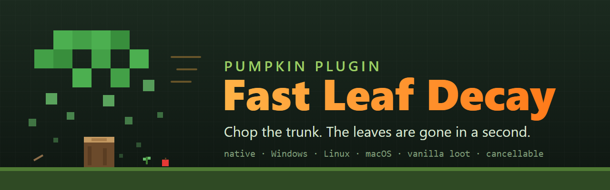

<p align="center">
  
</p>

<p align="center">
  <a href="https://github.com/Migno/pumpkinmc-plugin-fast-leaf-decay/releases/latest"></a>
  
  
  
  <a href="LICENSE"></a>
</p>

# Fast Leaf Decay for Pumpkin

Chop down a tree on your [Pumpkin](https://pumpkinmc.org) server and its leaves are gone within about a second, not after several minutes of slow random decay. Saplings, sticks and apples drop just as they do in vanilla.

- ⚡ **Fast:** leaves clear from the cut outward, so a normal tree is gone in under a second.
- 🌱 **Vanilla loot:** every leaf drops its normal loot table, so sapling farming keeps working.
- 🧱 **Vanilla rules:** a leaf only decays if no log is within 6 blocks through leaves, the same rule vanilla uses. Player-placed leaves never decay.
- 🛡️ **Plays nicely:** every decay fires `LeavesDecayEvent`, so protection and claim plugins can still cancel it.
- 📈 **Light on the server:** it only looks at the leaves of the tree you cut, never scans the world, and caps work at 512 leaves per tick.
- 🖥️ **Every platform:** builds for each official Pumpkin release binary on Windows, Linux and macOS.

## Install

1. Check your server version. This release supports **Pumpkin `0.2.2+26.3-26.60`**, the official binaries from [pumpkinmc.org/download](https://pumpkinmc.org/download/) and the [GitHub release](https://github.com/Pumpkin-MC/Pumpkin/releases/tag/0.2.2%2B26.3-26.60).
2. Download the plugin file for your server binary from the [latest release](https://github.com/Migno/pumpkinmc-plugin-fast-leaf-decay/releases/latest):

   | Your server binary | Plugin file |
   | --- | --- |
   | `pumpkin-X64-Windows.exe` or `pumpkin-X64-v3-Windows.exe` | `fast-leaf-decay-…-X64-Windows.dll` |
   | `pumpkin-ARM64-Windows.exe` | `fast-leaf-decay-…-ARM64-Windows.dll` |
   | `pumpkin-X64-Linux` or `pumpkin-X64-v3-Linux` | `fast-leaf-decay-…-X64-Linux.so` |
   | `pumpkin-ARM64-Linux` | `fast-leaf-decay-…-ARM64-Linux.so` |
   | `pumpkin-ARM64-macOS` | `fast-leaf-decay-…-ARM64-macOS.dylib` |

3. Put the file into the server's `plugins/` folder and restart. The log shows:

   ```
   INFO Fast leaf decay enabled plugin="fast-leaf-decay"
   INFO Loaded fast-leaf-decay (0.1.0)
   ```

That's all. There is nothing to configure.

> [!IMPORTANT]
> Use the plugin only with the Pumpkin release it was built for. Native Pumpkin plugins share Rust types with the server binary, so on any other build (another release, nightly, canary or a self-compiled server) the plugin can crash the server instead of failing cleanly. If your host auto-updates Pumpkin, pin it to the supported release, and update the plugin together with the server.

## How it works

1. A player breaks a log or a leaf block, or a leaf decays on its own.
2. The plugin collects the non-persistent leaves connected to that spot within 6 steps. These are the only leaves the change can leave without support.
3. Each leaf is checked after `4 + 2 × distance` ticks, so the tree clears outward from the cut.
4. A leaf with no log within 6 steps through leaves decays, following vanilla's `LeavesBlock.randomTick`: the event fires, the loot drops, and the block becomes air (or water if it was waterlogged). The plugin also shows the block-break particles and sound, so you can see the speed-up.

The plugin works out a leaf's support itself rather than waiting for the game's `distance` updates to spread through the tree. That's why it can act right away without decaying the wrong leaves.

**Limits:** explosions and fire don't trigger the plugin directly, because Pumpkin's `BlockBreakEvent` doesn't say which world they happened in. Those trees still speed up once their first leaf decays naturally. Leaves next to unloaded chunks are left alone.

## Compatibility

| Plugin | Pumpkin release | Minecraft |
| --- | --- | --- |
| 0.1.0 | `0.2.2+26.3-26.60` | Java 26.3 / Bedrock 1.26.60 |

There is no Android build yet.

## Building from source

The plugin is built as a member of the Pumpkin workspace at the supported release tag, the same way Pumpkin's release workflow builds the official binary: same compiler, and a whole-workspace `cargo build --release`. That gives the plugin the same dependency versions, features and type layouts as the server.

| File | Contents |
| --- | --- |
| `PUMPKIN_VERSION` | Pumpkin release tag to build against |
| `RUST_VERSION` | Compiler that release was built with (from its release workflow log) |

```bash
git clone https://github.com/Pumpkin-MC/Pumpkin.git
git -C Pumpkin checkout "$(cat PUMPKIN_VERSION)"
git -C Pumpkin submodule update --init --recursive
rustup toolchain install "$(cat RUST_VERSION)" --profile minimal
scripts/build.sh Pumpkin            # release build, for the official binaries
scripts/build.sh Pumpkin --debug    # debug build, for a debug server from the same checkout
```

`scripts/build.sh` copies the plugin into `Pumpkin/plugins/fast-leaf-decay` and adds it to the workspace members, so use a throwaway checkout.

### Tuning

These are constants at the top of [`src/lib.rs`](src/lib.rs):

| Constant | Default | Meaning |
| --- | --- | --- |
| `BASE_DELAY_TICKS` | 4 | Ticks from the break until the first leaf decays |
| `DELAY_PER_STEP_TICKS` | 2 | Extra ticks for each step away from the break |
| `MAX_DECAYS_PER_TICK` | 512 | Cap on leaves decayed per tick |
| `MAX_SEARCH_NODES` | 4096 | Cap on blocks visited by one search |

### Releasing

[`.github/workflows/release.yml`](.github/workflows/release.yml) builds every platform on the same runners Pumpkin uses. Pushing a `v*` tag publishes a GitHub release with all files and a `checksums.sha256`. Running the workflow manually only produces artifacts.

To support a new Pumpkin release:

1. Update `PUMPKIN_VERSION`.
2. Set `RUST_VERSION` from that release's workflow log (the `rustup update stable` step).
3. Fix anything the API changed, then bump the version and tag it.

## License

[GPL-3.0](LICENSE), because the plugin links against the GPL-licensed Pumpkin server crates.

This is a community plugin and is not affiliated with the Pumpkin project.
